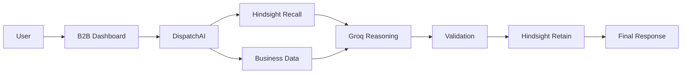

# CheersthePure DispatchAI

## B2B Supply & Distribution Intelligence Agent

CheersthePure DispatchAI is a B2B beverage supply assistant for distributor operations. It combines the existing CheersthePure business database, customer account data, persistent Hindsight memory, and Groq-based reasoning so a distributor can ask natural-language questions without losing context across sessions.

## Problem

B2B distributor relationships are built on recurring preferences, negotiated context, and operational constraints that are difficult to maintain in a normal stateless chatbot. A customer may repeatedly ask for certain delivery timings, order patterns, or preferred packaging, but without persistent memory those details are lost between conversations.

This is especially important in beverage distribution, where delivery windows, account history, pricing expectations, and product preferences matter to the customer relationship and operational efficiency.

## Solution

DispatchAI combines:

- CheersthePure business data
- the existing application database
- Hindsight persistent memory
- Groq AI reasoning
- controlled business validation and actions

The result is an AI assistant that can answer B2B questions with customer-specific context while staying grounded in authoritative business records instead of inventing unsupported pricing or commitments.

## Why Memory Matters

A normal stateless chatbot only responds to the current message. It cannot remember that a distributor prefers delivery after 4 PM, that they usually reorder the same 500 ml packs, or that a discount was never officially approved.

DispatchAI stores and recalls useful operational context using Hindsight so that future conversations can build on prior business relationships without confusing memory with transactional data.

## Architecture



## Core Workflow

User
→ B2B Dashboard
→ DispatchAI
→ Hindsight Recall
→ Business Data
→ Groq
→ Validation
→ Hindsight Retain
→ Response

## Key Features

- persistent B2B memory
- recurring customer context
- delivery preferences
- business-data grounding
- hallucination protection
- controlled actions
- customer-specific memory

## Technology Stack

The final implementation uses the actual technologies present in this codebase:

- Python
- Django
- SQLite for local development
- Django ORM for relational data
- Groq AI API
- Hindsight persistent memory service
- HTML, CSS, and JavaScript
- Stripe-ready payment flow
- Django authentication and authorization

## Demo

The evaluation demo uses a safe, controlled customer profile and live Hindsight integration. It includes three predefined scenarios:

1. Persistent delivery preference
2. Recurring order context
3. Unsupported discount / hallucination prevention

These scenarios are built around a demo customer and real memory recall/retain behavior, without fake final answers or simulated API responses.

## Security

Security is enforced in multiple layers:

- Django authentication and session-based access
- role-based authorization for B2B and admin views
- buyer identity resolution that ignores a non-staff caller’s attempted buyer override
- customer memory isolation by buyer ID
- secret masking for Groq and Hindsight configuration
- no raw API keys or private customer data exposed to end users

## Testing

Verified test command:

```bash
python manage.py test --verbosity 2
```

Result:

- 79 tests ran
- OK
- passed in 124.153s

## Installation

1. Create and activate a virtual environment.
2. Install dependencies:

```bash
python -m pip install -r requirements.txt
```

3. Copy the example environment configuration:

```bash
copy .env.example .env
```

4. Fill in the required environment variables locally.
5. Apply migrations:

```bash
python manage.py migrate
```

6. Start the app:

```bash
python manage.py runserver
```

## Environment Variables

List only variable names:

- DATABASE_URL
- STRIPE_PUBLIC_KEY
- STRIPE_SECRET_KEY
- STRIPE_WEBHOOK_SECRET
- EMAIL_BACKEND
- EMAIL_HOST
- EMAIL_PORT
- EMAIL_USE_TLS
- EMAIL_HOST_USER
- EMAIL_HOST_PASSWORD
- DEFAULT_FROM_EMAIL
- GROQ_API_KEY
- HINDSIGHT_API_KEY
- HINDSIGHT_URL
- HINDSIGHT_APP_ID
- DISPATCHAI_ENABLED
- DISPATCHAI_MAX_MSG_LENGTH
- DISPATCHAI_RECALL_LIMIT

## API

### DispatchAI endpoint

- POST /api/agent/chat

This endpoint accepts a JSON payload containing a user message and returns a grounded response along with memory usage, business-data usage, and action metadata. It requires an authenticated B2B user and belongs to the DispatchAI production layer.

## Future Improvements

- tighter production observability for memory quality and recall performance
- more structured business rule governance
- richer admin action controls and approval workflow
- evaluation dashboard for memory quality and grounding checks
- deeper analytics on reorder patterns and customer retention

## Summary

CheersthePure DispatchAI is a practical business agent for B2B distribution: it remembers what matters, checks real business data before answering, and refuses unsupported claims instead of hallucinating promises.
