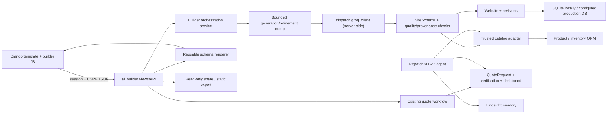

# SaaSsum AI — Minimal Safe Architecture

**Design date:** 2026-10-10  
**Scope:** Architecture for the SaaSsum AI website-builder MVP inside the existing
`Akhil0104/cheers_the_pure` Django project

This design is additive and intentionally small. It reuses the existing Django session/auth
layer, `CreatedWebsite` persistence, Pydantic schema, browser renderer, Groq client, quote
workflow, and deterministic catalog services. It does not introduce React, FastAPI, LangChain,
a new database, or a second AI provider wrapper.

## 1. Design goals and boundaries

### Goals

1. Deliver one reliable journey: brief → validated generated site → edit/refine → save →
   responsive preview → share/export → B2B inquiry.
2. Keep model output untrusted until deterministic validation and provenance checks pass.
3. Keep website-building concerns separate from DispatchAI’s B2B operational agent.
4. Preserve the existing storefront, quote, payment, and DispatchAI behavior.
5. Make failures explicit: unavailable AI, invalid schema, persistence failures, and unauthorized
   access must never look like success.

### Non-goals

- A general autonomous agent that can execute arbitrary code or browse the internet
- Freeform HTML/CSS/JavaScript generation
- A second frontend framework or API service
- Billing, custom domains, hosting automation, collaboration, or analytics
- Hindsight memory for ordinary website drafts unless a later requirement specifically needs it

## 2. System context

The existing project already provides the core platform:

- Django routes, templates, sessions, CSRF, authentication, and user ownership
- [`ai_builder/models.py`](../ai_builder/models.py) with `CreatedWebsite`
- [`ai_builder/schemas.py`](../ai_builder/schemas.py) with strict `SiteSchema`
- [`ai_builder/views.py`](../ai_builder/views.py) with generation, save/load, refinement,
  publishing, and inquiry endpoints
- [`ai_builder/static/ai_builder/renderer.js`](../ai_builder/static/ai_builder/renderer.js)
  and `app.js` for schema rendering and workspace interaction
- [`dispatch/groq_client.py`](../dispatch/groq_client.py) for server-side Groq access
- [`dispatch/services/catalog_service.py`](../dispatch/services/catalog_service.py) for
  authoritative Product/Inventory/order/quote reads
- [`app/quote_services.py`](../app/quote_services.py) for the existing quote workflow

The design should improve boundaries and observability around those pieces rather than replace
them.

## 3. Target architecture



The builder and DispatchAI may share deterministic business adapters and the Groq transport,
but they must not share prompts, sessions, authorization assumptions, or memory semantics.

## 4. Components

### 4.1 Versioned website schema

**Existing boundary:** [`ai_builder/schemas.py`](../ai_builder/schemas.py) already defines
`SiteSchema` version `"1.0"` and discriminated section models.

**Design:**

- Keep `schema_version` required and immutable for a saved document.
- Treat each schema version as a compatibility contract, not a loose JSON shape.
- Validate generated output, browser saves, section replacements, imports, and revisions with
  the same Pydantic models.
- Add a small explicit schema registry only when a second version is needed:

  ```text
  ai_builder/schema_registry.py
  - CURRENT_SCHEMA_VERSION
  - validate_site_document(data)
  - migrate_site_document(data, target_version)
  ```

- Do not silently coerce unknown fields or repair malformed model output. Reject it and return
  a user-safe error.
- Preserve the existing product provenance fields:
  `sample` products have no price; trusted database products require server-enriched price
  data.

### 4.2 Server-side AI provider access

**Reuse:** [`dispatch/groq_client.py`](../dispatch/groq_client.py) remains the only Groq
transport wrapper.

**Builder boundary:**

- Add a thin builder-facing adapter, such as
  `ai_builder/ai_provider.py`, only if the current view-level calls need isolation from
  provider response formatting.
- The adapter may call `dispatch.groq_client.chat`; it must not expose API keys or provider
  clients to the browser.
- Keep builder prompts in [`ai_builder/builder_prompts.py`](../ai_builder/builder_prompts.py),
  separate from [`dispatch/prompts/`](../dispatch/prompts/).
- Enforce bounded prompt/instruction lengths and strict JSON output.
- Return typed outcomes for success, invalid model output, timeout, unavailable provider, and
  unexpected provider failure.
- Never use Hindsight for builder drafts by default. Website drafts are owned application data,
  not buyer operational memory.

### 4.3 Generation and bounded orchestration

**Proposed service:** `ai_builder/services/generation.py`

Responsibilities:

1. Validate the authenticated owner and prompt length.
2. Create a generation operation identifier for logs/status.
3. Build a constrained prompt containing only allowed schema instructions and safe business
   context.
4. Call the shared Groq transport with bounded retries/timeouts.
5. Parse one JSON object with duplicate-key rejection.
6. Validate `SiteSchema`.
7. Run deterministic quality and provenance checks.
8. Persist only the validated document and initial revision.
9. Return a typed result suitable for the API.

The orchestration must not execute arbitrary tools, browse external URLs, mutate products,
modify orders, or submit quotes. The first MVP needs one generation call plus one selected
section refinement call, not a multi-agent loop.

### 4.4 Deterministic validation and quality checks

**Existing validation:** Pydantic constraints and `_has_untrusted_site_data` in
[`ai_builder/views.py`](../ai_builder/views.py).

**Proposed extraction:** `ai_builder/services/validation.py`

Checks:

- Pydantic schema validity and schema version
- unique section IDs and supported section types
- text and collection limits
- markup/script/event-handler rejection
- safe HTTP(S) image/footer URLs and constrained local links
- allowed action names only
- sample/live product provenance
- verified/sample testimonial provenance
- required primary section coverage for the MVP (at minimum a useful page structure; exact
  policy should be encoded as a deterministic validator, not a prompt promise)
- no duplicate JSON keys

Quality failures should identify the category and safe remediation (“regenerate with a shorter
description”), without returning raw provider output or internal exception details.

### 4.5 Safe reusable section rendering

**Reuse:** [`ai_builder/static/ai_builder/renderer.js`](../ai_builder/static/ai_builder/renderer.js)
already creates DOM nodes and uses `textContent`.

**Design:**

- Keep one renderer for editable workspace, read-only share pages, and export output.
- Pass explicit modes: `{editable, readOnly, previewMode}`.
- Render all text through DOM text nodes; never use generated `innerHTML`.
- Map schema actions to application-owned callbacks:
  `submit_b2b_inquiry`, `scroll_to_products`, `contact_business`, and `learn_more`.
- Treat live catalog fields as read-only in the editor; sample copy may be edited.
- Keep the section model as the renderer contract so a new section type requires schema,
  renderer, tests, and documentation together.

### 4.6 Website storage and revision history

**Existing model:** `CreatedWebsite` stores the latest validated schema, owner, prompt, publish
state, and timestamps.

**Minimal extension:**

- Keep `CreatedWebsite` as the current/draft aggregate.
- Add `WebsiteRevision` in [`ai_builder/models.py`](../ai_builder/models.py):

  ```text
  revision_id      UUID primary key
  site             ForeignKey(CreatedWebsite)
  revision_number PositiveIntegerField
  schema_version   short string
  schema_json      JSONField
  source           generation | inline_edit | section_refine | import | restore
  prompt_snapshot nullable text or safe hash/metadata only
  created_by       ForeignKey(User)
  created_at       DateTimeField
  ```

- Add a uniqueness constraint on `(site, revision_number)` and an index on
  `(site, -created_at)`.
- Write a revision in the same transaction as every successful site mutation.
- Keep revisions immutable. Restoring a revision creates a new revision with `source=restore`;
  it does not overwrite history.
- Do not store provider secrets, raw prompts from other users, or external API responses in
  revision metadata.
- Retain a bounded number of revisions per site in the MVP (for example, 50) only after the
  retention policy is agreed; deletion must be explicit and tested.

This is the only new database model needed for draft recovery. No new database technology is
required.

### 4.7 Inline editing and section regeneration

**Inline editing:**

- Browser updates an in-memory schema copy.
- Client marks the draft dirty and debounces a save.
- Server validates the complete document, checks site ownership and trusted data preservation,
  then atomically updates `CreatedWebsite` and creates a `WebsiteRevision`.
- Client marks “saved” only after the server response.

**Section regeneration:**

- Browser sends `site_id`, `section_id`, instruction, and an optional expected revision number.
- Server loads the owner-scoped current site.
- Server calls a section-specific constrained prompt.
- Replacement must preserve the selected section ID and type.
- Server replaces exactly one section, validates the complete document, checks trusted data
  preservation, and writes one revision transactionally.
- If the expected revision is stale, return `409 Conflict` rather than overwriting newer work.

### 4.8 Live responsive preview

- Continue using the existing `desktop`/`mobile` preview state and CSS class strategy.
- Keep content/schema identical between modes; only presentation changes.
- Add browser coverage for mode toggling, overflow, keyboard focus, content editing, and quote
  form usability at the mobile viewport.
- The preview is not a server-side rendered deployment. Shared/exported pages use the same
  read-only renderer with backend actions disabled where appropriate.

### 4.9 CheersThePure catalog retrieval

**Reuse:** [`dispatch/services/catalog_service.py`](../dispatch/services/catalog_service.py)
already reads Product and Inventory records deterministically.

**Preferred boundary:** create a neutral adapter
`ai_builder/services/catalog.py` that calls a shared lower-level catalog function, or move
only genuinely generic formatting into a shared module. Do not make the builder call
DispatchAI orchestration.

Flow:

1. Generation may produce sample product placeholders only.
2. A server-side enrichment step optionally maps approved product identifiers/capacities to
   `Product` records.
3. The adapter reads price/inventory from ORM records.
4. It writes `data_source="cheersthepure_database"` and integer INR minor units only for
   records it independently found.
5. Missing/ambiguous products remain sample or are omitted; the LLM cannot invent a match.
6. Renderer labels sample content and displays trusted prices only when provenance is valid.

The initial reliable MVP may defer live enrichment and clearly label it partial; it must not
fake catalog integration.

### 4.10 B2B inquiry

- Keep `QuoteRequest` as the system of record.
- Reuse [`app/quote_services.py`](../app/quote_services.py) through a narrow builder adapter,
  not by duplicating quote creation logic.
- Keep B2B/staff authorization, idempotency UUID, validation, rate limiting, email verification,
  and generic persistence errors at the existing API boundary.
- The public shared page remains read-only. Inquiry submission is enabled only in the
  authenticated workspace and only for eligible accounts.
- A successful browser message is shown only after the API returns the persisted quote ID and
  safe status data.
- Do not allow a generated schema to select an arbitrary endpoint; the action remains the
  allowlisted `submit_b2b_inquiry` callback.

### 4.11 Public sharing and static export

- Keep `share_token` on `CreatedWebsite` for the minimal MVP.
- Publish only validated current schema data through the read-only shared route.
- Never include prompt, owner, revision metadata, cookies, credentials, or private quote data.
- Continue generating export HTML from the trusted renderer and current validated schema.
- Keep backend-dependent operations unavailable in offline export and explain that boundary in
  the exported UI.
- If revocation is required later, add `published_at`/`revoked_at` or a publication model;
  do not overload revision history for access control.

## 5. DispatchAI reuse versus separation

### Reuse

- `dispatch.groq_client` for the single server-side Groq transport
- Generic deterministic catalog reads, if extracted behind a neutral interface
- Existing `QuoteRequest` workflow for B2B inquiry persistence
- Django authentication/session/CSRF and shared logging conventions
- Existing safe configuration and secret masking utilities where applicable

### Keep separate

- Builder prompts, schema validation, generation/refinement orchestration, and revision logic
- DispatchAI buyer identity rules and B2B agent authorization
- DispatchAI conversation sessions/messages/decisions
- Hindsight recall/retention and buyer memory banks
- DispatchAI business-rule response validation, action tools, and operational order workflows
- Builder UI state and website schema from DispatchAI chat state

The rationale is safety and boundedness: DispatchAI is an authenticated operational assistant
with memory and transactional context; SaaSsum is a constrained content-generation workflow.
Sharing the agent pipeline would expand the website builder’s authority and create unnecessary
prompt/memory leakage risk.

## 6. API and transaction boundaries

Existing routes should remain stable:

| Concern | Route | Boundary |
|---|---|---|
| Workspace | `GET /builder/` | Authenticated user |
| Generate | `POST /api/site-builder/generate/` | Prompt → validated saved site |
| Save/list | `GET|POST /api/site-builder/sites/` | Owner-scoped schema |
| Load/update | `GET|PUT /api/site-builder/sites/<uuid>/` | Owner-scoped atomic update |
| Refine | `POST /api/site-builder/refine/` | One section, owner-scoped |
| Publish | `POST /api/site-builder/sites/<uuid>/publish/` | Owner-scoped read-only token |
| Inquiry | `POST /api/v1/inquiry/submit/` | B2B/staff, idempotent quote workflow |
| Share | `GET /builder/share/<token>/` | Published public schema only |

When revision history is added, mutation responses should include `revision_number` and mutation
endpoints should accept an optional expected revision for optimistic concurrency. Existing
clients can continue working if the fields are additive.

## 7. Expected files

### Existing files to preserve or change carefully

- [`ai_builder/schemas.py`](../ai_builder/schemas.py): schema versioning and any new section fields
- [`ai_builder/models.py`](../ai_builder/models.py): `WebsiteRevision`
- [`ai_builder/views.py`](../ai_builder/views.py): thin request/response boundary only
- [`ai_builder/builder_prompts.py`](../ai_builder/builder_prompts.py): bounded generation/refinement prompts
- [`ai_builder/tests.py`](../ai_builder/tests.py): API, ownership, provenance, revision, and failure tests
- [`ai_builder/static/ai_builder/app.js`](../ai_builder/static/ai_builder/app.js): revision/status
  handling and UI state
- [`ai_builder/static/ai_builder/renderer.js`](../ai_builder/static/ai_builder/renderer.js):
  shared safe rendering and action mappings
- [`ai_builder/templates/ai_builder/workspace.html`](../ai_builder/templates/ai_builder/workspace.html):
  activity/status/revision controls if needed
- [`ai_builder/templates/ai_builder/shared_site.html`](../ai_builder/templates/ai_builder/shared_site.html):
  read-only rendering boundary
- [`app/quote_services.py`](../app/quote_services.py): reuse only; avoid duplicating workflow
- [`dispatch/groq_client.py`](../dispatch/groq_client.py): reuse only; avoid builder-specific behavior
- [`dispatch/services/catalog_service.py`](../dispatch/services/catalog_service.py): reuse or
  extract generic catalog reads
- [`app/urls.py`](../app/urls.py): add revision endpoints only if the UI needs them

### Expected new files

- `ai_builder/services/__init__.py`
- `ai_builder/services/generation.py`
- `ai_builder/services/validation.py`
- `ai_builder/services/catalog.py`
- `ai_builder/services/revisions.py`
- `ai_builder/migrations/0002_websiterevision.py`
- Optional `ai_builder/schema_registry.py` when schema version 1.1 is introduced
- Optional `ai_builder/management/commands/prune_site_revisions.py` only after a retention
  policy is approved
- Browser test file/config only if the repository adopts a browser runner; do not add a new
  browser framework solely for the design document

### Documentation updates

- [`docs/BUILDER_WORKSPACE.md`](./BUILDER_WORKSPACE.md): revision API, status semantics, and
  catalog boundary
- [`docs/SITE_SCHEMA.md`](./SITE_SCHEMA.md): new schema version/sections and migration policy
- [`docs/SAASSUM_REQUIREMENTS.md`](./SAASSUM_REQUIREMENTS.md): update statuses as features are
  verified
- [`docs/SAASSUM_BASELINE.md`](./SAASSUM_BASELINE.md): record regression test results

## 8. Testing architecture

### Django/Python tests

Add focused tests without weakening the current 113-test baseline:

- schema version acceptance/rejection and migration behavior
- generation success, malformed JSON, duplicate keys, provider unavailable, timeout, and
  no-persistence-on-failure
- deterministic quality checks and provenance enforcement
- revision creation on generation/save/refinement, immutable history, restore, and stale
  revision conflicts
- owner isolation for every revision/site endpoint
- section refinement changes exactly one section
- catalog enrichment uses ORM values and refuses arbitrary client prices
- inquiry creates one `QuoteRequest` per idempotency key and preserves existing workflow
- share/export excludes private fields and disables backend actions when read-only
- no secret leakage in JSON responses or activity records

### Browser tests

Use the repository’s eventual supported browser tooling, or manual browser checks if no browser
runner is currently present:

1. Login and empty workspace
2. Prompt submission and progress/error state
3. Generated renderer and section selection
4. Desktop/mobile toggle at actual viewport sizes
5. Inline edit → debounce/save → reload
6. One-section refinement
7. Saved library and revision restore
8. Publish/share signed out and read-only behavior
9. Offline export
10. Invalid/valid inquiry and duplicate retry

Browser tests should use mocked Groq responses and non-production quote/email services. No test
should call paid AI APIs or real Stripe transactions.

### Commands

```powershell
python manage.py check
python manage.py migrate --plan
python manage.py test ai_builder
python manage.py test --verbosity 1
```

The existing test database isolation should be retained. A browser test command should be
documented only after the project selects and installs a supported runner.

## 9. Incremental implementation sequence

1. Extract generation/validation logic from the view into typed services without behavior
   changes; rerun the 113-test baseline.
2. Add transactional `WebsiteRevision` creation for existing save/refine/generate paths.
3. Add revision listing/restore with optimistic concurrency and focused tests.
4. Add the deterministic catalog adapter/enrichment path, initially behind an explicit feature
   boundary and test fixtures.
5. Improve activity statuses based on real server outcomes, not simulated agent steps.
6. Add browser coverage for the complete journey.
7. Only then consider conversational follow-ups if the challenge rubric requires multi-turn chat.

## 10. Architectural risks and decisions requiring confirmation

- **Schema version policy:** version 1.0 is already persisted; migrations must preserve old
  sites. Do not change fields in place without a migration/compatibility path.
- **Revision retention:** choose a bounded retention policy before implementing cleanup.
- **Catalog matching:** ambiguous natural-language product names must remain sample/unknown,
  never be guessed into a live product.
- **AI retries:** retry only bounded, idempotent generation calls; never retry inquiry creation
  without its idempotency key.
- **Browser runner:** select one supported tool later; avoid adding a second frontend stack.
- **Production cache/database:** shared cache is required for multi-worker inquiry rate limits;
  current local SQLite/cache settings are development-oriented.

This architecture is sufficient for the MVP while preserving the existing project’s strongest
boundaries: server-side AI access, strict schema validation, trusted SQL data, owner-scoped
storage, and the established quote workflow.
